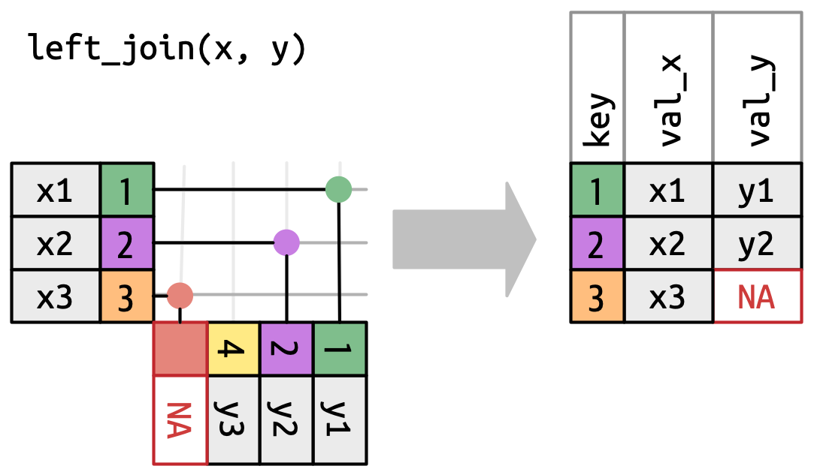

```{r setup, include=FALSE}
knitr::opts_chunk$set(echo = TRUE, message = FALSE, warning = FALSE)
```

# Learning objectives

By the end of this part you should be able to:

1. Explain what a covariate is, and add one to a DESeq2 design formula.
2. Use exploratory plots to check whether a covariate explains structure in your samples.
3. Compare results with and without a covariate and explain why they differ.

# Background: Proper biological context

In the first part of the lab, the `~ condition` model found very few (subjective)
differentially expressed genes between KO and WT. After the experiment, the researcher
learned one more piece of information that wasn't in the original sample sheet: 
the 8 mice came from **three different litters**. This information was technically
already hiding in the mouse IDs, since consecutive numbers come from the same
litter.

| mouse | litter |
|-------|--------|
| 840, 841, 842, 843 | L1 |
| 857, 858 | L2 |
| 891, 892 | L3 |

Mice from the same litter share parents, a mother, a cage, and a birth date. That
can make littermates' gene expression more similar to each other than to mice
from other litters, regardless of genotype.

We will re-visit a similar phenomenon later in the semester when we talk about
single cell. 

A **covariate** is a variable that isn't what you're testing but still affects your
measurements. If you leave it out of the model, the variation it causes gets counted as
noise, and the real effect you care about can get lost in that noise.

**Q0.1** Look back at the mouse IDs in your PCA and heatmap from the first part. Does
litter match the structure you saw?

---

# Part 1: Set up the data

## 1.1 Packages

```{r libraries}
library(tidyverse)
library(DESeq2)
library(pheatmap)
library(RColorBrewer)
```

## 1.2 Read and clean the counts

This is the same code as the first part of the lab.

```{r read-clean}
counts <- read_tsv("all_verse_counts.tsv") %>%
  select(-1) %>%                                   # drop the leftover row-number column
  rename_with(~ str_remove(.x, "_count"))          # remove "_count" from every column name
```

## 1.3 Add litter to the sample table

```{r coldata}
coldata <- tibble(sample = colnames(counts)[-1]) %>%
  separate(sample, into = c("condition", "mouse"), remove = FALSE) %>%
  mutate(condition = factor(condition, levels = c("WT", "KO")))


# We make a new tibble that encodes the litter information
litter_map <- tibble(
  mouse  = c("840", "841", "842", "843", "857", "858", "891", "892"),
  litter = c(rep("L1", 4), rep("L2", 2), rep("L3", 2))
)

```


We are going to take advantage of columns that hold the same information in each
table to perform what's known as a `join` operation. Specifically, we are going 
to use a `left_join` which will keep all entries from the dataframe on the `left`
even if there is no corresponding match in the `right` dataframe. We are able to
do this because the common elements (mouse column) match in both dataframes. 



Look up the syntax for `left_join` in tidyverse and join the two tables:

```{r}
# TODO: left_join litter_map onto coldata; make litter a factor
coldata <- coldata %>%
  


coldata
```

**Q1.1** Make a table of `condition` by `litter` with `table()` and the columns
from coldata.
Does every litter contain both WT and KO mice?

```{r}

```

## 1.4 Build the DESeq2 object

DESeq2 convention is to put the variable you're testing **last** in the design formula and
any covariates before it. This will 

```{r dds-build}
mat <- counts %>% column_to_rownames("gene_id") %>% as.matrix()

dds_cov <- DESeqDataSetFromMatrix(countData = mat,
                                  colData   = coldata,
                                  design    = ~ litter + condition)

# Same filter as the first part of the lab
keep <- rowSums(counts(dds_cov) >= 10) >= 4
dds_cov <- dds_cov[keep, ]
```

---

# Part 2: Does litter explain the structure?

```{r vst-pca}
vsd <- vst(dds_cov, blind = TRUE)

pca_df <- plotPCA(vsd, intgroup = c("condition", "litter"), returnData = TRUE)
percentVar <- round(100 * attr(pca_df, "percentVar"))

ggplot(pca_df, aes(x = PC1, y = PC2, color = litter, shape = condition)) +
  geom_point(size = 3) +
  labs(x = paste0("PC1: ", percentVar[1], "% variance"),
       y = paste0("PC2: ", percentVar[2], "% variance"))
```

```{r dist-heatmap}
sampleDists <- dist(t(assay(vsd)))
sampleDistMatrix <- as.matrix(sampleDists)
anno <- as.data.frame(colData(vsd)[, c("condition", "litter")])
colors <- colorRampPalette(rev(brewer.pal(9, "Blues")))(255)
pheatmap(sampleDistMatrix,
         clustering_distance_rows = sampleDists,
         clustering_distance_cols = sampleDists,
         annotation_row = anno,
         show_colnames = FALSE,
         col = colors)
```

**Q2.1** What does PC1 separate now that the points are colored by litter?

**Q2.2** In the heatmap, do samples cluster by litter or by genotype?

---

# Part 3: Comparing the two models

We fit both models on the same filtered data so the comparison is fair.

```{r deseq-both}
# The original model: ~ condition
dds_naive <- dds_cov
design(dds_naive) <- ~ condition
dds_naive <- DESeq(dds_naive)
res_naive <- results(dds_naive, name = "condition_KO_vs_WT")

# The revisited model: ~ litter + condition
dds_cov <- DESeq(dds_cov)
res_cov <- results(dds_cov, name = "condition_KO_vs_WT")
```

```{r cov-tibble}
# TODO: convert res_cov to a tibble, arrange by padj
res_tbl <- res_cov %>% as_tibble(rownames = "gene_id") %>% arrange(padj)
res_tbl
```

**Q3.1** How many genes are significant at `padj < 0.1` in each model?
Hint: You can take advantage of how TRUE values are counted. 

```{r sig-counts}

```

---

# Part 4: Genes gained by adding the covariate

Generate code that will create a list of genes that are significant
at the **same** threshold from the res_naive and res_cov tables. 

Then, find genes that are considered significant only after adding litter
to the model. 

```{r gained-find}
# Significant genes (padj < 0.1) from each model
sig_naive <- res_naive %>%


sig_cov <- res_cov %>%
  

# Genes significant ONLY after adding litter to the model
gained <- 
```

```{r gained-pick}
# Pick the top gained gene. To look at a different one, replace this with any
# gene_id from the `gained` table, e.g. gene_of_interest <- "ENSMUSG00000030172.15"
gene_of_interest <- gained$gene_id[1]

# Compare its statistics in the two models
tibble(
  model          = c("~ condition", "~ litter + condition"),
  log2FoldChange = c(res_naive[gene_of_interest, "log2FoldChange"],
                     res_cov[gene_of_interest, "log2FoldChange"]),
  padj           = c(res_naive[gene_of_interest, "padj"],
                     res_cov[gene_of_interest, "padj"])
)
```

I've given you code that should show you the counts of the gene you choose that was
significant in the new model including the covariate. Use the plots to help cement
your understanding of covariates in modeling. 

```{r gained-plot}
# Normalized counts for that gene, joined to the sample info (condition, litter)
plot_df <- counts(dds_cov, normalized = TRUE)[gene_of_interest, ] %>%
  enframe(name = "sample", value = "norm_count") %>%
  left_join(as.data.frame(colData(dds_cov)), by = "sample")

# View 1: one bar per mouse, grouped by litter, WT before KO within each litter
plot_df <- plot_df %>% arrange(litter, condition) %>%
  mutate(sample = factor(sample, levels = sample))

ggplot(plot_df, aes(x = sample, y = norm_count, fill = condition)) +
  geom_col() +
  facet_wrap(~ litter, scales = "free_x") +
  labs(title = gene_of_interest, subtitle = "One bar per mouse, split by litter",
       x = NULL, y = "Normalized counts") +
  theme(axis.text.x = element_text(angle = 45, hjust = 1))

# View 2: the same points, colored by litter, with each litter's WT and KO means joined
ggplot(plot_df, aes(x = condition, y = norm_count, color = litter)) +
  geom_point(size = 3) +
  stat_summary(aes(group = litter), fun = mean, geom = "line", linewidth = 1) +
  labs(title = gene_of_interest, subtitle = "Colored by litter",
       x = NULL, y = "Normalized counts")
```


**Q4** Change `gene_of_interest` to two or three other genes from `gained` and
re-run the plots. Is the pattern the same?

---

# Part 5: Other things you're asked to do in Project 2

## Joining the gene names

Your pipeline should have generated a delimited-file that contains the mapping
of every ensemble gene ID to its corresponding gene symbol (human readable gene
names). 

Once you have performed differential expression, you'll often want to convert 
those IDs to symbols to be more easily interpretable. As above, you would first
read in the gene id to symbol mapping into a tibble based on how your file is
delimited, `read_csv` for commas and `read_tsv` for tabs. You woudl then use a 
`join` to join that tables information (gene symbol) into the DE results table 
on the common column (gene_id). You will need to look at the function definition
to handle the situation where your columns that hold the keys have different names. 

You can practice here with the included file. Remember that this is species-specific,
so this will only be valid for mice. 


## Generating a ranked list of genes by Log2FoldChange

Once you have joined the gene names into your DE results table, you can use
a combination of `select`, `arrange`, and `pull` to generate a ranked list of
gene names and their associated fold change value. 

## Generating a list of significant genes

With your DE results table, you can use `filter` to generate just a table
containing genes meeting your significance threshold. You can then write only
these results to a new file so that you can easily copy / paste them into DAVID
or Enrichr. 

## Running FGSEA

You will need to download a GMT file (format for holding gene sets) from the 
MSigDB website and upload it to your repo. The `fgsea` package includes some
helper functions that will read the GMT file into the appropriate format that it
needs. 

## Plotting

We will not be covering plotting in depth in this course. You are not expected
to memorize ggplot syntax, but you are expected to be able to read generated 
plotting code well enough to tell what data it uses and what it does to that data.
If you need a refresher, the data visualization chapters of R for Data Science
(r4ds.hadley.nz) are a good starting point.

Plotting can be quite challenging, in part because every plotting library has its
own style and logic that you have to learn. In R, ggplot2 is built on the grammar
of graphics, where you map columns of your data to aesthetics and add layers one
at a time. Base R plotting works more like drawing on a canvas, one command after
another. In Python, matplotlib is notoriously opaque: it offers two overlapping
interfaces (the state-based pyplot style and the object-oriented figure/axes style),
and even simple customizations can require large amounts of time reading about
layers of objects and documentation. Fluency in one of these does not transfer
neatly to another, and remembering the exact syntax for a specific tweak is
often more trouble than it’s worth.

This is where LLMs can genuinely help. Generating plotting code is one of the 
relatively safer things they can do. Unlike an analysis step, where a subtle 
error can  change your results, a plotting error is usually visible: you can look
at the figure and check it against the numbers in your data. We should always be
mindful of distorting our data, but the risk is lower as long  as you verify what
you see. Adding on to this, most plotting code in ggplot can be written such that
any transformations like filter or arrange happen through a pipe and therefore
leave the original data untouched. 

Before accepting a generated plot, ask yourself a  few questions. Does the plot
use the columns you intended (for example, adjusted p-values rather than raw p-values
in a volcano plot)? Are the axes, scales, and transformations appropriate and
clearly labeled? Do the patterns in the plot agree with what you see when you
inspect the underlying table directly, such as the number of significant genes
or the direction of the largest fold changes? Has anything been dropped, filtered,
or changed without your knowledge? You can inspect the magnitude and range of the
values in the underlying table and check to see if those are reflected in your
plot. 

Treat the LLM as a fast way to get a first draft of the code to generate a plot,
and ensure that you critically review it. 